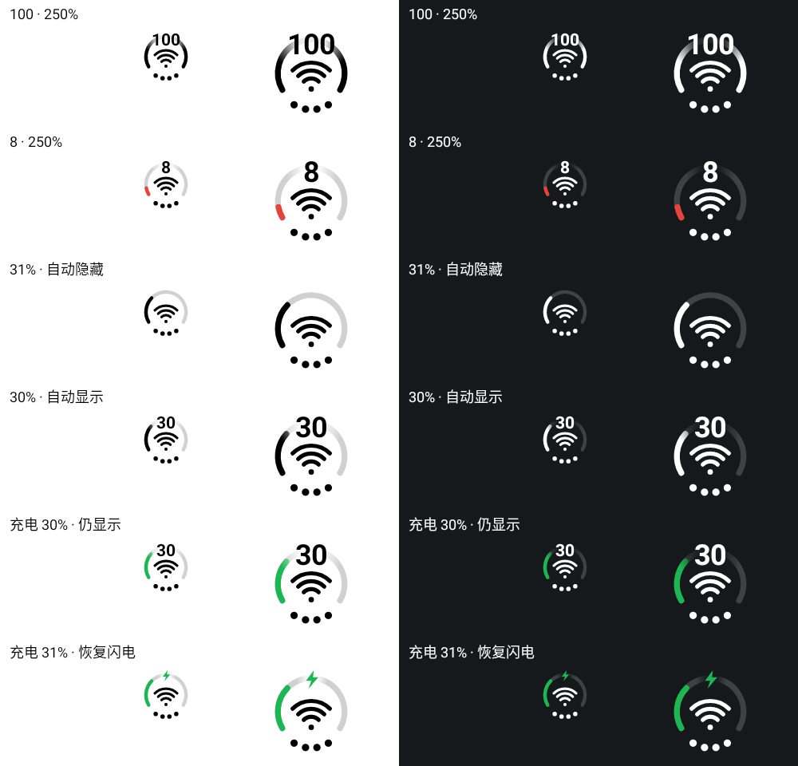
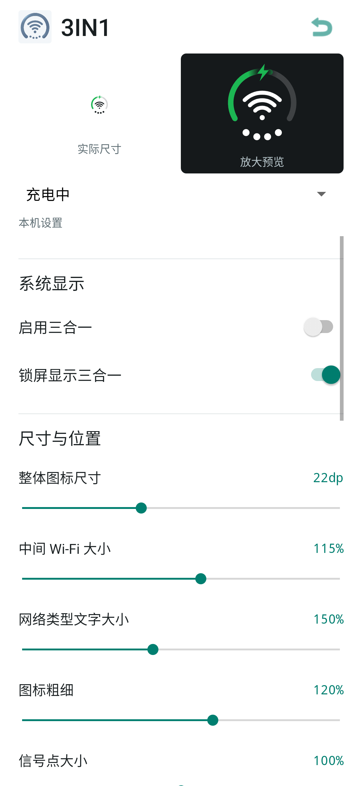

# 3IN1

> **0.1.9 compat。** 基于 ColorOS 16 机型开发与验证，不是全机型支持声明；其他 Android/ColorOS 版本不作兼容保证。

**0.1.9 compat / versionCode 10** 新增中心电量常显、设置联动和通知栏/控制中心下拉头部覆盖，中心数字按电量圆弧圆心居中。新开关默认关闭，升级后保留原有设置。更新说明见 [0.1.9](docs/releases/v0.1.9.md)，适用范围见 [兼容说明](docs/COMPATIBILITY.md)。

[0.1.9 下载](https://github.com/FangFangTu150/3IN1/releases/tag/v0.1.9) · [提交问题](https://github.com/FangFangTu150/3IN1/issues) · [安装与恢复](docs/INSTALL.md)

3IN1 是需要 Root/LSPosed（或兼容 legacy Xposed 框架）的 Android 模块，在 SystemUI 原有电池宿主内绘制电量、Wi-Fi 与蜂窝信号组合指示器。

## 范围与边界

- 覆盖状态栏、锁屏以及满足结构契约和接管能力检查的通知栏/控制中心下拉头部；可显示电池环、充电/充满/插电未充电、低电量、省电、Wi-Fi 等级、无互联网/需登录、2G/3G/4G/5G、移动数据关闭、漫游、SIM 异常和飞行模式。无法完整接管的下拉组保留原生图标。
- VoLTE、VoWiFi 和未注册提示继续使用原生图标，不由组合图标承接。
- 不修改 QS 快捷设置磁贴、详情页或 AOD，不注入其他应用，不提供遥测、常驻轮询、快充检测或性能模式检测。
- 继承 SystemUI 父级防烧屏移动，但不能保证 OLED 不老化。

## 兼容性范围

| 项目 | 值 |
| --- | --- |
| 开发与验证范围 | ColorOS 16 / Android 16 / API 36 |
| 历史 0.1.6 真机验证 | 一加 13 / `PJZ110` / `PJZ110_16.0.10.501(CN01)` |
| 0.1.9 目标设备 | `PLK110` / `PLK110_16.0.3.502(CN01)`；验收范围见兼容说明 |
| 开发与用户测试框架 | LSPosed Irena `1.9.2 (7249)`，API 100（非运行时版本 gate） |
| 作用域 | 仅 `com.android.systemui` |
| legacy Xposed | `minversion 93` |

运行时不再按精确型号、固件构建号或 SystemUI 版本阻断；反射契约不满足或运行时异常时仍会回退原图标。项目仅基于 ColorOS 16 机型开发，其他 Android/ColorOS 版本不作保证；不同 ColorOS 16 机型仍需自行真机验收。

## 配置默认值

设置页共有 21 个持久化参数；越界数值会按实现边界收敛，颜色输入为 `#RRGGBB`。错误类型按键回退默认值，不清空其他设置。

| 键 | 默认值 | 范围/含义 |
| --- | --- | --- |
| `enabled` | `false` | 启用系统替换 |
| `lockscreen` | `true` | 锁屏显示 |
| `size` | `22dp` | `16-32dp` |
| `wifiScale` | `115%` | `70-150%` |
| `textScale` | `150%` | 网络类型文字 `80-250%` |
| `stroke` | `120%` | `60-160%` |
| `dotScale` | `100%` | 信号点 `60-140%` |
| `dotSpacing` | `100%` | 信号点间距 `70-125%` |
| `horizontalPadding` | `2dp` | `0-8dp` |
| `verticalOffset` | `0dp` | `-4..4dp` |
| `colors` | `true` | 启用状态颜色 |
| `chargingColor` | `#1CB753` | 充电与充满颜色 |
| `lowColor` | `#E7433A` | 电量小于等于低阈值 |
| `saverColor` | `#FFB300` | 省电模式 |
| `lowThreshold` | `20%` | `5-50%`，含等于 |
| `showNumber` | `false` | 始终显示电量数字 |
| `numberScale` | `115%` | `75-250%` |
| `autoNumber` | `false` | 低于或等于阈值自动显示 |
| `numberThreshold` | `20%` | `1-100%`，含等于 |
| `centerNumber` | `false` | 中心始终显示电量，保留顶部充电状态标记 |

0.1.8 起，常显与自动显示互斥，充电闪电和充满对勾始终优先于数字；旧配置两项均开启时保留常显。未知电量不会触发自动显示。有效百分比即使充放电状态为 UNKNOWN 仍可驱动进度和低电量逻辑，但不会伪造充电/充满/暂停标记。

“电量数字中间常显”独立于顶部数字模式：开启后以电量圆弧圆心显示电量（未知显示 `?`），替代所有中心网络内容；顶部保留充电/充满/暂停标记。Wi-Fi 大小、网络文字大小、顶部常显、自动数字及数字阈值锁定并保留原值，关闭后恢复；数字大小继续可调。

## 证据边界

0.1.6 本地构建、Lint 和 55 项 JUnit/Robolectric 测试通过；一加 13 / `PJZ110` 真机验证已通过，但本地测试不执行真实 ART/Xposed hook，其他机型仍需单独验收。

0.1.9 的102项本地测试、构建和Lint通过；目标设备已验证覆盖安装、SystemUI重建、主栏/锁屏/下拉接管、原生恢复及20次展开收起。真实切卡、运营商IMS、横屏/分栏和定量性能等未测项目见兼容说明，不将正常路径通过扩展为全量验收。

## 安装与恢复

1. 从 [0.1.9 Release](https://github.com/FangFangTu150/3IN1/releases/tag/v0.1.9) 下载 `3IN1-0.1.9-compat.apk` 与同名 `.sha256`，校验后覆盖安装，不要清除数据；也可自行构建。
2. LSPosed 只勾选 `com.android.systemui`，不要选 Android Framework 或所有应用。
3. 启用作用域后重新打开 3IN1，让激活前设置迁移到共享目录；应用默认关闭替换。
4. 重启 SystemUI 或设备，刷新诊断后再启用替换。应用不会自动重启。
5. 异常时先在应用中关闭/恢复原图标；若应用打不开，在 LSPosed 停用 3IN1 后重启。反复崩溃时使用现有 Root/LSPosed 安全恢复流程。

`compat` 是非 debug APK，但使用现有 debug/test 签名以保持测试安装更新兼容；签名密钥不发布，跨签名覆盖安装会失败。

详细文档：

- [安装、更新与恢复](docs/INSTALL.md)
- [功能与设置参数](docs/SETTINGS.md)
- [构建说明](docs/BUILD.md)
- [功能边界与验收状态](docs/COMPATIBILITY.md)
- [0.1.6 候选预发布说明](docs/releases/v0.1.6.md)
- [更新日志](CHANGELOG.md)
- [贡献指南](CONTRIBUTING.md)
- [安全说明](SECURITY.md)

作者：[Coolapk / 17348848](https://www.coolapk.com/u/17348848)

许可证：**暂未指定**。
